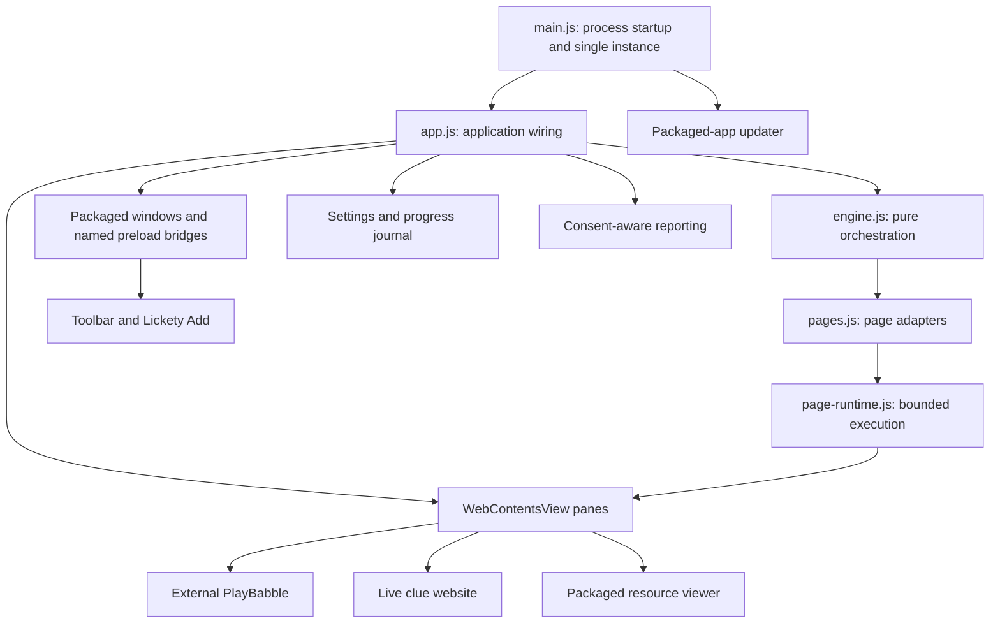
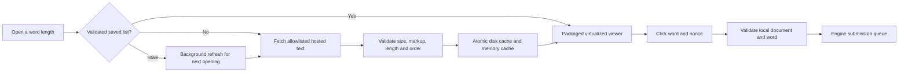

# Desktop architecture and logic flows

[Documentation home](README.md) · [Implementation reference](AGENT-REFERENCE.md)

Babble Expert is an Electron desktop client for Windows and macOS. It embeds the external PlayBabble game and either clue website, adds local tools, and synchronizes accepted words. It does not own game accounts or the authoritative dictionary. This describes source checked on **29 October 2026**, not the version currently installed by every player.

## Process and component model



[`src/main.js`](../src/main.js) owns process lifecycle, single-instance activation, startup logging, app creation and updater initialization. [`src/app.js`](../src/app.js) creates the main window, toolbar and three native `WebContentsView` panes, auxiliary windows, IPC wiring and services. [`src/engine.js`](../src/engine.js) is an EventEmitter-based component without Electron dependencies; it coordinates word entry, queues and reconciliation. [`src/pages.js`](../src/pages.js) translates those operations into narrowly selected page APIs/DOM. Keep page-specific quirks in adapters rather than the engine.

The toolbar renderer uses packaged HTML/CSS/JS in [`src/ui`](../src/ui). Native views are positioned above the renderer; layout IPC sets their bounds. A renderer loading placeholder cannot cover a visible native view, so the view is hidden while the placeholder is required. Reapply zoom when documents become ready; inspect resize, source switch, hidden clues and both Resources-side arrangements after layout changes.

## Trust and session boundaries

All windows/views use sandboxing, context isolation and disabled Node integration. Packaged preloads expose named `contextBridge` operations. [`src/local-window.js`](../src/local-window.js) checks the expected web contents, main frame and remembered local document URL before accepting local IPC. Remote IPC checks the expected pane, top frame and allowed document host. Auxiliary navigation/window creation is denied unless a feature explicitly allows it. A host check alone is not a substitute for sender/frame checks.

Babble and Clues use `persist:babble`; Resources uses `persist:resources`. These cookies are separate from Chrome/Edge and Expert does not save passwords. [`src/browser-tools.js`](../src/browser-tools.js) separates HTTP cache clearing from confirmed site-data/login reset. PlayBabble navigation is canonicalized to `https://playbabble.com` to preserve host-specific login behaviour.

## Startup and shutdown

Startup installs the single-instance lock and local error logging before creating windows. Activation arriving before readiness is queued. The main window is shown/restored/focused through explicit lifecycle handling rather than relying entirely on one `ready-to-show` event. Optional diagnostic sharing reads saved consent; local startup logs are never automatically uploaded.

When ready, the app loads settings, constructs the UI/services, loads the remote panes and starts single-flight engine polling. The updater is initialized only for packaged Windows/macOS. Normal development launch uses live websites and a development profile; fixture tests and preview tools supply isolated profiles/endpoints.

On shutdown/update installation, wait for pending engine work, flush settings and the progress journal, and allow only bounded reporting flush time. A remote reporting failure must not hold the process open indefinitely. See [`src/startup.js`](../src/startup.js), [`src/settings.js`](../src/settings.js), [`src/progress-journal.js`](../src/progress-journal.js) and [`src/updates.js`](../src/updates.js).

## Word entry, submission and reconciliation

```mermaid
sequenceDiagram
    participant Player
    participant UI as Local UI or page entry
    participant Engine
    participant Adapter as Page adapters
    participant Game as PlayBabble
    participant Clues as Clue page
    Player->>UI: Enter word, tile path or resource word
    UI->>Engine: Named operation with validated payload
    Engine->>Engine: Classify input; check readiness and grid identity
    Engine->>Adapter: Queue eligible word operation
    Adapter->>Game: Submit using bounded execution
    Game-->>Adapter: Explicit result or uncertain outcome
    Adapter-->>Engine: Result with page/puzzle guards
    Engine->>Clues: Update compatible clue bridge when safe
    Engine-->>UI: Confirmed, duplicate/uncertain or rejected feedback
    Engine->>Adapter: Later read accepted lists for reconciliation
```

Normal entry is limited to 500 characters, with multiline and suspected bulk-list safeguards. Ctrl+Enter/Command+Enter overrides suspected single-line word-list classification, not every safety limit. Ordinary chat Enter remains usable. The explicit Create Clues path has a separate trusted bulk limit. [`src/create-clues.js`](../src/create-clues.js) also supports deliberate individual-word definition requests; it does not send a whole word list to the definition provider.

All transfer paths share queues, pacing and duplicate suppression. Before automatic transfer, both pages must be ready and have matching 25 row-major grid letters; Q remains one tile in this identity. Legacy clue numbers are not reliable matching keys. PlayBabble's saved-word request can finish after document load, so `babbleWordListReady` matters as well as DOM readiness.

The engine normally ticks about once per second without overlapping work. It reconciles accepted lists both ways and checks for completion; slower hint/identity work is separately paced. Switching clue source triggers safe resynchronization. Changes to grid or page revision invalidate delayed work.

[`src/page-runtime.js`](../src/page-runtime.js) bounds execution and rejects operations after navigation, destruction, crash or deadline. A rejected deadline does not guarantee already-running JavaScript was cancelled. Check visible/server accepted state before retrying an uncertain submission. Explicit rejection is not endlessly retried; chat is not automatically replayed. Recovery may repair accepted-word display from the game's word list without reloading away a draft. See [`src/page-recovery.js`](../src/page-recovery.js).

Green means confirmed acceptance; amber means duplicate, uncertain or Clues-only; red means explicit rejection. The recent-entry history is in-memory for the current session and is not usage telemetry.

## Website compatibility

The bridge contract includes `AddBabbleWord`, `GetAllWords` and `showAll`; modern clues also expose `AddBulkWord`. Add status values are strings `0` absent, `1` added and `2` duplicate. `GetAllWords` is newline-delimited. Compatibility `showAll` must preserve All/On/Off. Keep answer/checkbox/entry hooks used by the preloads when modifying hosted pages.

[`src/preload-puzzle.js`](../src/preload-puzzle.js) adjusts embedded controls while retaining the underlying bridge DOM. Standalone browser controls remain available. Expert owns embedded fireworks/sound/reporting; browser clues defer their own celebration when embedded. This avoids duplicate overlays and reports.

## Resources data and rendering



[`src/resources.js`](../src/resources.js) selects fixed `words-4.html` through `words-12.html` GitHub Pages resources. [`src/word-list-data.js`](../src/word-list-data.js) fetches them as text with strict host/path, redirect, timeout, size and word validation. It parses exact compact word markup rather than executing downloaded scripts. Saved lists have a 24-hour freshness policy; failures retain the prior validated copy. Normal HTTP cache clearing and the app's validated dictionary files are different caches.

[`src/word-list-index.js`](../src/word-list-index.js) provides indexed lookup/visible ranges; [`src/ui/word-list.js`](../src/ui/word-list.js) renders visible rows plus a buffer and resets recycled row state. Sparse results are keyed to the puzzle and survive changing lengths. Guard asynchronous navigation so an old load cannot reveal the wrong resource. Do not replace this with full-list rendering/scanning or refresh content under a player's pointer.

Older Expert versions execute the hosted list scripts. The Babble generator must therefore preserve both its compact data markup for current Expert and interactive click/copy/hash behaviour for old clients. Reference-dice conflict shading is advisory, not a rule for rejecting a word.

## State, privacy and update flows

| State/service | Owner and contract |
| --- | --- |
| Settings | `src/settings.js`: validated schema, debounced atomic replacement and explicit migrations; preserve later user choices |
| Progress journal | `src/progress-journal.js`: bounded local summaries, active-time accounting, explicit CSV export; no raw grid/full word history uploaded; preserve unreadable data until deliberate recovery/clear |
| Usage | `src/telemetry.js`: opt-in, stable random installation identity; username linking is separately optional and self-reported |
| Diagnostics | `src/diagnostics.js`: consent-aware allowlisted payloads and bounded expiring queue; local support state remains useful without sharing |
| Contact | `src/lickety-message.js`: deliberate message submission; optional contact fields and separate username-link acknowledgment |
| Updates | `src/updates.js`: packaged Windows updater; macOS latest-release check and DMG offer; bounded retries and manual feedback |
| What's New | `src/update-highlights.json`, `src/release-history.json`: bundled offline content; pending acknowledgment is separate from last-run version |

Journal active time excludes hidden/locked/sleeping/idle/disconnected or stale intervals; it is different from reported app-open duration. Settings, cookies and the journal live in the local app profile and are outside the web runtime backup. See [Privacy](../PRIVACY.md) for the user-facing policy.

Windows downloads updates through `electron-updater` and can install after state has been flushed and work is idle, or on a later quit. macOS offers an unsigned DMG for manual replacement. Both depend on correctly published GitHub release assets; CI's draft creation alone does not make an update available. See the shared [build/release handbook](https://github.com/licketySplitAUS/SelfServeClues/blob/main/docs/BUILD-AND-RELEASE.md).

## Testing and extension points

Pure engine/data logic belongs in unit tests under `test/unit`; page/view/lifecycle behaviour uses Electron fixtures under `test/e2e`. Run through `test/e2e/run.js` to isolate the working directory and inherited Electron environment. Resource fixtures can require `WORD_LIST_DIR`. Packaged smoke checks verify actual binaries separately from development Electron. See `.github/workflows/build.yml` for the current full gate and the [implementation reference](AGENT-REFERENCE.md) for focused tests.

When adding a feature, choose its owner first: pure decision in the engine/helper, external-page detail in the adapter/preload, application wiring in `app.js`, local presentation in `src/ui`, or hosted behaviour in the web repository. Preserve sender/puzzle guards, bounded work and explicit user consent at the boundary. Update this document when that boundary changes.
